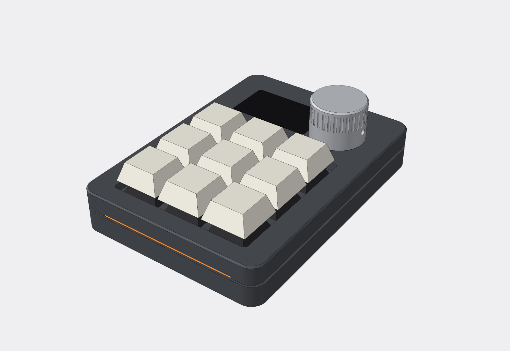

# greycode

A 3 x 3 macropad with a knob and an OLED that changes with the app in front.
FreeCAD in focus: the keys become views, undo and visibility, the OLED shows their names, the edge
light turns orange. A build fails: the edge blinks red and says why.

Keymaps are edited live in [Vial](https://get.vial.today). App profiles, labels, colours and
host actions live in one TOML file that the PC daemon `greyd` reloads on save.

*A render of the case model, not a photo.*

> **Status: design files and software only. Nothing has been built.**
> No board ordered, no case milled, no firmware flashed. Every claim below is what the design files
> and their automatic checks say.

## Status

Checked on 2026-11-15 by running the commands in the last column.

| Part | State | Check |
|---|---|---|
| Firmware | QMK/Vial for RP2040; builds `firmware/dist/greycode_vial.uf2` (vial-qmk `dd43959a`) | `just firmware` |
| Host link (pad side) | 10 native tests pass under ASan + UBSan | `just test-firmware` |
| greyd, greyctl | 45 tests pass, clippy and rustfmt clean. sway backend ran live; Hyprland against fake sockets only; X11 read once on XWayland | `just test-host` |
| FreeCAD add-on | 11 tests against a fake greyd. Not run inside FreeCAD | `just test-freecad` |
| Configurator | Core 32 tests, UI logic 9 tests pass. **Window not built**: needs `webkit2gtk-4.1` | `just test-configurator` |
| PCB | Generated KiCad 9 board, 4 layers, 66 x 96 mm. 892 tracks, 213 vias, 0 unrouted pads. DRC 0 violations, 0 unconnected, 0 parity issues; ERC clean; 8 `board.toml` contract groups match; rebuild byte-repeatable; 48 generator tests | `just pcb`, `just pcb-test` |
| Order files | JLCPCB Gerbers, drill, BOM (22 lines, LCSC numbers), CPL (78 parts); agree with the board. Bottom-side rotations not verified | `just pcb-fab` |
| Case | build123d model, 6061-T6. Self-test 20 of 20; 990 part pairs at rest and 429 pressed, 0 clashes; walls and metal between cuts at least 1.0 mm; inside corners R1.5 wherever the tool reaches over 3 mm; STEP and STL read back clean | `just cad` |
| Pins | 12 checks: firmware and greyd agree with `board.toml` | `just check` |
| Real hardware | **None** | - |

## What it is

| | |
|---|---|
| MCU | RP2040, USB-C |
| Keys | 9 x MX on hot-swap sockets, one GPIO each |
| Knob | EC11 with push. Tap: mute. Hold: FN layer |
| Display | 1.3" 128 x 64 OLED (SH1106, I2C): profile name, the nine key labels, alert text |
| Light | 9 per-key RGB, 6 edge LEDs behind a slot in the case for alerts and the profile colour |
| Firmware | QMK + Vial: 16 layers, encoder map, macros, tap dance, combos, VialRGB |
| Host | `greyd` (Linux: sway, Hyprland, X11), `greyctl`, FreeCAD add-on, configurator |
| Case | Milled 6061-T6 top shell with built-in switch plate and base, knurled knob, frosted light strip in a shadow gap, smoked lens. 77 x 107 x 17.6 mm, 35.0 mm to the knob top. Seven M2 x 10 screws from below |
| PCB | RP2040, W25Q128JVS, USB-C on the underside, 9 hot-swap sockets, 15 SK6812 (9 per key, 6 side-emitting at the front edge), 4 layers |

## Stock keymap

Layer 0 is the base; layers 1-14 are app profiles; 15 is FN (hold the knob).
Edit any of it in Vial; `KC_TRNS` in a profile falls through to the base layer.

| Layer | Keys, row by row | Knob |
|---|---|---|
| 0 Base | Prev Play Next / Copy Paste Undo / HOST0 HOST1 HOST2 | Volume |
| 1 FreeCAD | Iso Front Right / Top Hide Delete / Undo Redo Esc | Zoom |
| 2 KiCad PCB | Route Drag Move / Rotate Via Props / Fill Delete Esc | Zoom (F1/F2) |
| 3 Browser | Reopen New Close / Back URL Forward / Zoom- Zoom0 Zoom+ | Tabs |
| 4 Sketcher | Line Circle Rect / Coincident Horizontal Vertical / Dimension Construction Esc | Zoom |
| 15 FN | RGB on/off, next effect, hue / sat, speed, brightness / -, -, **bootloader** | Brightness |

## Use it

1. **Flash.** Hold BOOT, plug in (or double-tap reset), copy `firmware/dist/greycode_vial.uf2` to the
   `RPI-RP2` drive.
2. **Install greyd** and the udev rule: [host/README.md](host/README.md).
3. **Profiles.** Copy `host/config.example.toml` to `~/.config/greycode/config.toml` and edit it.
4. **Keys.** Open Vial, change a profile's layer. It applies at once.
5. **Alerts.** `greyctl alert error "CI failed" --timeout 60`.
6. **FreeCAD states.** Install the add-on ([freecad/README.md](freecad/README.md)): opening a sketch
   switches the pad to the Sketcher layer.

Before ordering anything, read the open points in [pcb/README.md](pcb/README.md) and
[cad/README.md](cad/README.md), and [docs/architecture.md](docs/architecture.md#open-points).

## Work on it

| Command | Does | Needs |
|---|---|---|
| `just test` | Firmware link, greyd, configurator, FreeCAD add-on, PCB generator, pins (under a minute) | gcc, Rust, Python 3.11+, node |
| `just cad` | Case checks, STEP/STL, renders (about 1 minute) | `cad/.venv` (see `cad/README.md`) |
| `just pcb` | Schematic, placement, routing, DRC, contract, order files | Docker, `kicad/kicad:9.0.9` |
| `just firmware` | Fetch pinned vial-qmk (first run), build the UF2 in the QMK container | Docker |
| `just host-run` | greyd from source with the example config | Rust, sway |

`board.toml` holds pins and parts. Change a pin there, then in `firmware/greycode/`, then run
`just check`.

## Where things are

| Path | What |
|---|---|
| [`board.toml`](board.toml) | Pins and parts; the source the firmware (and later PCB and case) is checked against |
| `firmware/greycode/` | QMK keyboard: `keyboard.json`, `greycode.c` (glue), `hostlink.c` (protocol, no QMK), `keymaps/vial/` |
| `firmware/test/` | Native tests and the protocol vectors shared with greyd |
| [`pcb/`](pcb/README.md) | Board generator (`gen/`), generated KiCad project, JLCPCB files in `fab/` |
| [`cad/`](cad/README.md) | Case model, checks, STEP/STL in `exports/`, machine-shop notes |
| [`configurator/`](configurator/README.md) | Tauri app: `core` (logic), `ui` (HTML/JS), `src-tauri` (shell) |
| [`freecad/`](freecad/README.md) | FreeCAD add-on that reports workbench and Sketcher state to greyd |
| [`host/`](host/README.md) | `greyd` and `greyctl` (Rust), example config, udev rule, systemd unit |
| [`docs/architecture.md`](docs/architecture.md) | How it fits together, failure behaviour, roadmap |
| [`docs/protocol.md`](docs/protocol.md) | Host link wire format |
| `docs/legacy/` | Photos of the hand-wired Pro Micro prototype this replaces |
| `tools/check_pins.py` | Firmware and greyd against `board.toml` |

## License

No license file yet. Until one is added, nobody else has the right to reuse this.
