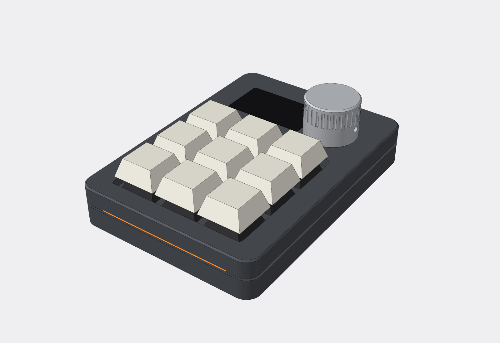
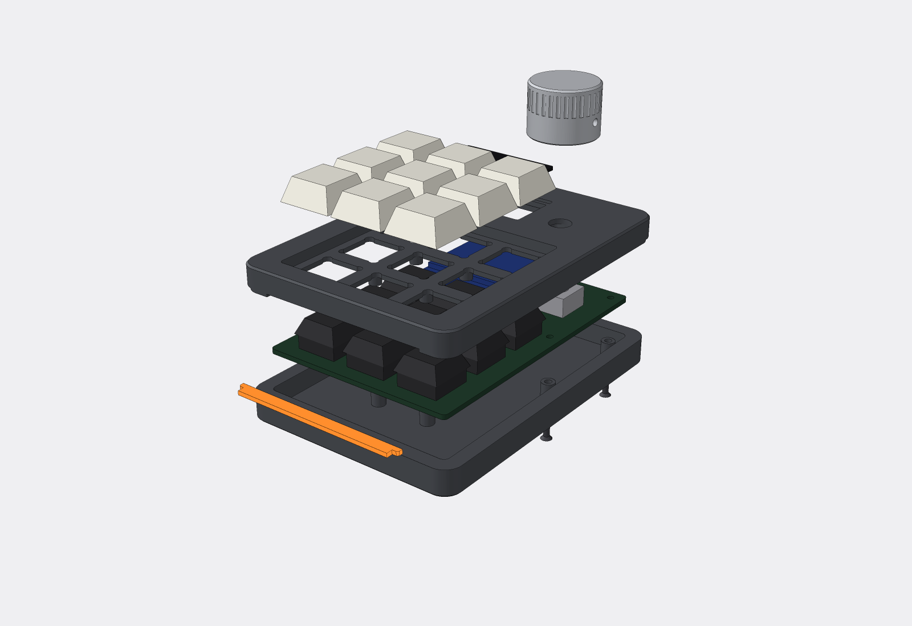
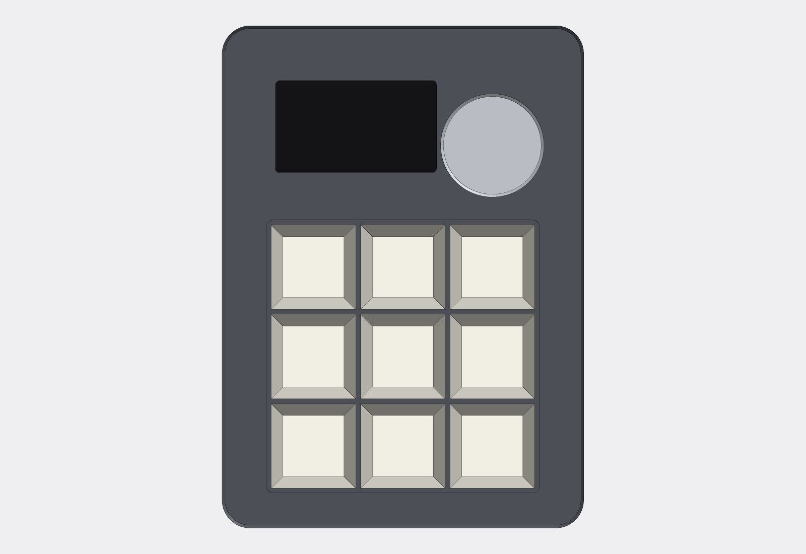
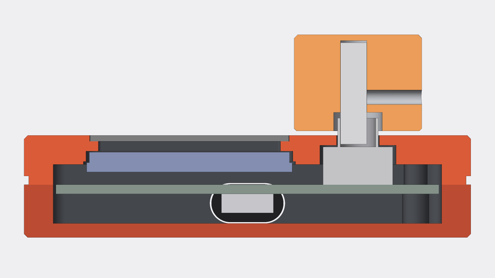
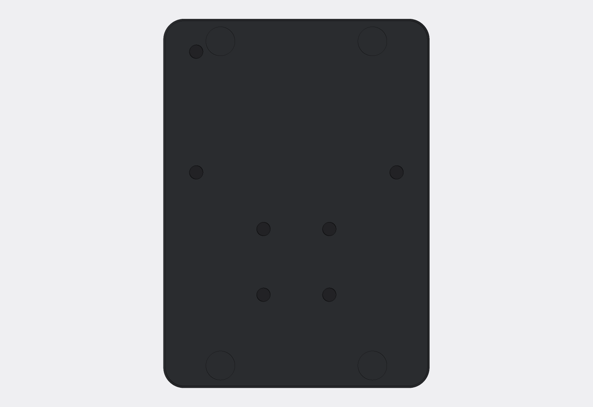

# greycode case (CNC aluminium)

> **Status: a model, not a part. Nothing has been machined, assembled or measured.**
> Every size of a bought part is a drawing value or a guess (MEASURE list below). The checks prove
> the model is consistent with those guesses, nothing more.
> Every check passes (2026-11-15). The USB-C receptacle is on the PCB's **bottom** face, as the
> generated PCB has it (`pcb.usb_face`), so it no longer runs into the OLED module.



Parametric build123d model. Reads `board.toml` (`[pcb]`, `[case]`, `[keys]`, `[leds]`) at run time;
no number from there is repeated in the code. That includes `pcb.usb_face` (`"top"` or `"bottom"`;
any other value stops the build with an error), `pcb.usb_mouth_overhang` and `pcb.oled_module_size`.

## Run it

```bash
cad/.venv/bin/python cad/build.py check    # all checks, writes cad/exports/checks.json, exit 1 on a failure
cad/.venv/bin/python cad/build.py export   # STEP + STL per part, assembly.step, each file read back
cad/.venv/bin/python cad/build.py render   # PNGs into docs/images/cad/
cad/.venv/bin/python cad/build.py all      # the three above; exit 1 if any failed (57 s measured)
cad/.venv/bin/ruff check cad/greycode_case cad/build.py
```

The venv holds build123d 0.13, trimesh, numpy, matplotlib, rtree (`pyproject.toml`), and ruff.

## Parts

| Part | Made how | Size (mm) | Mass |
|---|---|---|---|
| Top shell | 6061-T6, CNC, 2 setups + back face for the USB notch | 77 x 107 x 8.5 (z 9.1 to 17.6) | 74.2 g |
| Base | 6061-T6, CNC, 2 setups + back face for the USB opening | 77 x 107 x 9.1 (z 0 to 9.1) | 83.3 g |
| Knob | 6061-T6, lathe + 4th axis (or live tooling) for the flutes | 22 dia x 16.6 (z 18.4 to 35.0) | 15.4 g |
| Light strip | Frosted acrylic, laser cut, 1.4 sheet | 60 x 4.1 (front tongue 56) | - |
| Lens | Smoked glass or acrylic, 1.0 sheet | 34.22 x 19.5, R0.9 | - |

Masses from the solid volumes (27492.9, 30858.89, 5695.42 mm^3) at 2.70 g/cm^3.
Case height 17.6 (underside to top face, feet excluded); 35.0 to the knob top.

| | |
|---|---|
|  |  |
|  |  |

The section is the plane through the knob axis (y = 76), seen from the front: knob on the EC11 shaft,
encoder pocket and bushing hole, OLED module under its window and lens. Behind the plane: the USB-C
receptacle hanging under the PCB and the opening round it in the back wall, which reaches 0.3 into
the top shell.

## Design notes

- **Stack.** Base z 0 to 9.1, floor 2.4, pocket 6.7 deep. PCB z 7.5 to 9.1, its top on the joint
  plane. Top shell z 9.1 to 17.6: cavity up to the plate underside (12.6), 1.5 mm plate web, key well
  3.5 deep down to the plate top (14.1). Outer outline = PCB + 5.5, corner R6.0.
- **Floor: kept thin, pocket made deeper.** When `pcb.bottom_z` went from 5.0 to 7.5 the floor stayed
  near 2.5 and the pocket grew. A 5.0 floor would have kept the old 0.65 to the hot-swap sockets, but
  the receptacle hangs to z 4.24 inside the PCB outline and would cut into it, and the bottom-face
  parts (RP2040, buttons, ...) get 5.1 mm of room instead of 2.5. The floor top is 2.4, not 2.5: at
  2.5 its edge at the back wall's inner face came 0.186 from the plug overmold (limit 0.2). At 2.4 it
  is level with the opening's lower edge.
- **Fasteners: changed from the brief.** The brief asked for four M2.5 screws at the corners. With a
  5 mm wall, R6 outer corners and the R2 cavity corner, a countersunk M2.5 head cannot keep 1 mm of
  metal to the outside (it breaks through the bottom chamfer) while its shank keeps 1 mm to the
  cavity. Instead seven **M2 x 10 countersunk screws (ISO 10642)** come up through base bosses, through
  the seven PCB holes, into the top shell's tapped standoffs. One stack clamps base, PCB and top. The
  base bosses (dia 4.6, z 2.4 to 7.5) and top standoffs (dia 4.0) sit inside `pcb.hole_keepout_diameter`
  (5.0 now; the check reads it from `board.toml`, 0.2 radial margin). The heads sit 1.1 up inside the
  floor (short dia 4.0 counterbore, then the 90 degree seat), so the screw reaches 2.08 mm into the
  thread, 0.92 short of its end, while the tap drill point keeps 1.0 mm of metal under the key-well
  floor. Why 1.1: M2 x 8 no longer reaches the standoff after the 2.5 mm lift; with M2 x 10 a 1.0
  recess gives 1.98 engagement (limit 2.0) and a 1.5 recess leaves 0.922 of metal between the
  countersink and the boss foot (limit 1.0, measured with a 2.5 floor).
- **Shadow gap: 1.5 tall, not 1.0.** The top shell's outer face steps in 0.8 for its lowest 1.5 mm.
  The light channel is cut from below to the same height. With a 1.0 gap over a 1.5 channel, a lip
  0.8 x 0.5 mm would stay above the strip.
- **Light strip.** Frosted acrylic rests on the base rim, front edge flush with the gap face, back
  edge 0.6 from the PCB front edge where the six side LEDs (`leds.edge_x`) shine in. It is 2 mm wider
  on each side behind the front wall (ears), so it cannot slide out. The channel corners behind the
  ears are R0.5; the ears are chamfered 0.6 to clear them.
- **OLED.** Module underside 2.2 above the PCB (needs a low-profile header, MEASURE). Board pocket
  ceiling 13.1, glass pocket ceiling 14.9, both R1.5 (cut from the joint face: 4.0 and 5.8 deep) (glass top 0.2 below it), window ledge 1.7 thick, lens recess
  1.0 deep with a 1.5 ledge, window = active area + 1.0 per side. The glass top is 0.2 under the
  **underside** of the ledge, not under its top: with 0.2 under the top the ledge would be 0.2 thick.
  The module height is set by the key well: the board pocket keeps 1.001 mm of metal to the well floor.
- **Encoder and knob.** EC11 pocket 13.16 square, R1.5, z 12.59 to 15.9
  (0.3 over the body); bushing hole dia 7.4. Knob
  dia 22, 0.8 above the top face; pressed (0.5 travel) it is 0.3 mm above it. Counterbore dia 8.4 for
  the bushing (0.5 above it when pressed), blind D-bore 6.05 / 4.55 across the flat to 0.4 past the
  shaft tip, M3 grub screw onto the flat, 30 flutes R0.6 x 0.5 deep in the upper band. The band starts
  1.0 above the M3 thread crest; the check measures 1.062 from the thread envelope to the flutes.
- **Switch plate.** 14.0 x 14.0 cutouts with dog-bone reliefs (R1.5) in each corner, so a square MX
  housing fits. R1.5, not R0.5: the cutter reaches 5.0 (3.5 well + 1.5 plate), so it gets a 3 mm tool.
  The keycaps hide the reliefs.
- **USB-C on the bottom face.** HRO TYPE-C-31-M-12 under the PCB (`pcb.usb_face = "bottom"`), centred
  on `pcb.usb_x` = 33.0, mouth `pcb.usb_mouth_overhang` = 0.5 past the back edge, which puts it on the
  back wall's inner face. Shell envelope 8.94 x 7.35 x 3.26, z 4.24 to 7.5; centre 1.6 below the PCB
  underside (z 5.9, MEASURE). The 13 x 7 opening with round ends runs from the wall's inner face out,
  z 2.4 to 9.4: almost all in the base, plus a 0.3 notch in the top shell above the joint (the
  overmold top is at 9.15, above the PCB top). Round the plug overmold (12.4 x 6.5, MEASURE, front
  face 0.1 beyond the mouth, guess) it leaves 0.25 to both shells. The overmold's underside is 2.65
  above the case underside, so a plugged cable does not touch the table. The bottom chamfer (0.6) and
  the back feet (x 11 and 55, 8.4 dia) are well clear of the opening (x 26.5 to 39.5, bottom 2.4).
- **Joint tolerance.** The PCB is clamped between base bosses and standoffs while the rims meet on the
  joint plane. A PCB thicker than 1.6 opens the joint by the difference; the shadow gap hides that.
  Not checked against a real PCB.

## Checks

`build.py check` on 2026-11-15, exact output:

```text
self-test: 20 of 20 known faults and sound shapes judged right
soundness: 45 of 45 parts are one valid closed solid
interference (at rest): 990 pairs, 0 clashes
interference (keys and knob pressed (moving parts only)): 429 pairs, 0 clashes
  keycaps at rest to top shell: 2.634 mm (min 0.4)
  keycaps pressed to top shell: 0.828 mm (min 0.4)
  knob pressed to top shell: 0.3 mm (min 0.2)
  hot-swap sockets to base: 1.511 mm (min 0.3)
  USB plug overmold to top shell: 0.25 mm (min 0.2)
  USB plug overmold to base: 0.25 mm (min 0.2)
  USB plug overmold above the case underside (table plane, feet excluded): 2.65 mm (min 0.0)
  USB plug overmold in the opening (radial, inside the back wall): 0.25 mm (min 0.2)
  standoff and base boss inside pcb.hole_keepout_diameter (radial margin): 0.2 mm (min 0.0)
  M2 screw tip below end of thread: 0.92 mm (min 0.2)
  M2 thread engagement in standoff: 2.08 mm (min 2.0)
wall top: thinnest 1.199 mm at [40.85, 20.43, 9.5] (6000 samples, min 1.0)
wall base: thinnest 1.099 mm at [63.98, 90.83, 5.47] (6000 samples, min 1.0)
wall knob: thinnest 1.0 mm at [49.87, 77.28, 34.0] (6000 samples, min 1.0)
metal between cuts top: 1.001 mm, key well / oled board pocket (min 1.0)
metal between cuts base: 1.416 mm, foot 4 / M2 countersunk 7 envelope (min 1.0)
metal between cuts knob: 1.062 mm, flutes / M3 set screw envelope (min 1.0)
inside corners top: smallest R0.5 (light channel), 0 sharp, tool reach over 3.0 mm: encoder pocket R1.5 (6.8 from bottom), key well R1.5 (3.5 from top), oled board pocket R1.5 (4.0 from bottom), oled glass pocket R1.5 (5.8 from bottom), switch 1 R1.5 (5.0 from top), switch 2 R1.5 (5.0 from top), switch 3 R1.5 (5.0 from top), switch 4 R1.5 (5.0 from top), switch 5 R1.5 (5.0 from top), switch 6 R1.5 (5.0 from top), switch 7 R1.5 (5.0 from top), switch 8 R1.5 (5.0 from top), switch 9 R1.5 (5.0 from top), cavity R2.0 (3.5 from bottom); exempt none
inside corners base: smallest R2.0 (interior pocket), 0 sharp, tool reach over 3.0 mm: interior pocket R2.0 (6.7 from top); exempt none
inside corners knob: smallest R3.025 (d bore), 0 sharp, tool reach over 3.0 mm: d bore R3.025 (15.6 from bottom); exempt {'flutes: ball end mill along the knob axis (4th axis or live tooling), not a vertical cutter': 30, 'D-bore flat corners: broached': 2}
screw holes top: 7, least metal 1.0 mm (M2 standoff 1, min 1.0)
screw holes base: 7, least metal 1.094 mm (M2 countersunk 1, min 1.0)
screw holes knob: 1, least metal 1.094 mm (M3 set screw, min 1.0)
```

`build.py export`: 5 part STEPs and `assembly.step` (45 solids) read back valid with volume errors
below 1e-13 (largest 4.1e-14); 5 STLs watertight, volume within 3.8e-04 of the solid. Exact lines:

```text
top.step: 1 solids, valid True, volume off by 2.1e-14
top.stl: 26744 triangles, watertight True, volume off by 1.2e-05
base.step: 1 solids, valid True, volume off by 4.5e-15
base.stl: 17158 triangles, watertight True, volume off by 1.2e-05
knob.step: 1 solids, valid True, volume off by 4.1e-14
knob.stl: 9476 triangles, watertight True, volume off by 3.8e-04
light_strip.step: 1 solids, valid True, volume off by 1.7e-16
light_strip.stl: 36 triangles, watertight True, volume off by 3.2e-07
lens.step: 1 solids, valid True, volume off by 2.9e-15
lens.stl: 524 triangles, watertight True, volume off by 1.5e-06
assembly.step: 45 solids, valid True, volume off by 2.5e-14
exported 5 parts and assembly.step to cad/exports; 0 faults reading them back
```

What each check does:

| Check | How | Limit |
|---|---|---|
| Soundness | every case and reference part: one solid, valid, volume > 0 | - |
| Interference | all pairs: bounding boxes, then boolean common volume; again with keys and knob pressed | 0.001 mm^3 |
| Clearances | BRep distance between solids; plug also clipped to the back wall for the radial gap; plug underside above z 0; keepout margin from `board.toml` | keycaps 0.4, knob 0.2 (guess), sockets 0.3, plug 0.2, plug to table 0, keepout 0 |
| Walls | 6000 area-sampled surface points, ray along the inward normal to a near-parallel exit face | 1.0 |
| Metal between cuts | distance between every two cuts of a part that do not meet, and from each screw hole's metal envelope (thread major dia or countersink) to every cut | 1.0 |
| Inside corners | every concave vertical cylinder face that is not a full hole, plus vertical edges with no radius; tool reach from a ray up and down the air column over each corner | R0.5; R1.5 if the reach is over 3 mm; no vertical access fails |
| Screw holes | everything within t of the thread (major dia) or countersink, along the hole, must be metal; largest t searched | 1.0 |
| Self-test | the same functions on 20 shapes: overlapping vs touching boxes, 0.6 vs 1.5 walls, R0 / R0.3 / R1 / deep-R1 / deep-R1.5 pockets, R1 vs R1.5 pocket nested in another pocket (reach 4), M2 1.6 vs 4.0 from an edge, one vs two solids, pockets 0.5 vs 2.0 apart, parts 0.3 vs 0.6 apart, a pin through a plate | all judged right |

Limits of the checks: the wall check samples, so a very small thin spot can be missed; "metal between
cuts" skips cuts that meet, so a sliver left where two cuts overlap is only seen by the wall check;
reference parts are envelopes, not real parts; tool reach looks at one air column per corner and
assumes the stock's top or bottom face is the entry face. Nothing checks strength, thermal or anodise
build-up.

### Inside corners by feature

"Reach" is how far the cutter must go below the face it enters through (top face 17.6 or joint face
9.1 for the top shell), not the height of the corner wall. Nested pockets add up: the OLED glass
pocket wall is 1.8 tall but sits 5.8 above the joint face.

| R | Feature | Wall | Reach, from | Tool |
|---|---|---|---|---|
| 0.5 | light channel behind the ears | 1.5 | 1.5, bottom | 1 mm end mill |
| 0.5 | OLED window | 1.7 | 2.7, top (through the lens recess) | 1 mm |
| 1.0 | lens recess | 1.0 | 1.0, top | 2 mm |
| 1.5 | switch cutout dog-bones | 1.5 | 5.0, either side (well or cavity) | 3 mm |
| 1.5 | OLED board pocket | 0.5 | 4.0, bottom | 3 mm |
| 1.5 | OLED glass pocket | 1.8 | 5.8, bottom | 3 mm |
| 1.5 | key well | 3.5 | 3.5, top | 3 mm |
| 1.5 | encoder pocket | 3.3 | 6.8, bottom | 3 mm |
| 2.0 | cavity | 3.5 | 3.5, bottom | 3-4 mm |
| 2.0 | base interior pocket | 6.7 | 6.7, top | 4 mm |
| 3.025 | knob D-bore | 12.4 | 15.6, bottom (through the counterbore) | drill + broach |

Every corner the cutter reaches more than 3 mm for has R1.5 or more (checked per corner). Exempt by
design: the knob flutes (cut with a 1.2 ball end mill along the knob axis) and the two corners of the
D-bore flat (broached).

## Machine-shop note

- **Material** 6061-T6. **Finish** bead blast (fine glass bead), then Type II sulphuric anodise:
  shells graphite or black, knob clear. Mask or re-tap the M2 and M3 threads after anodising.
- **Tolerances** ISO 2768-mK unless stated. Edges break 0.1 to 0.2 unless chamfered in the model.
- **Fits that matter:** switch cutouts 14.00 +0.05/0 with R1.5 dog-bones; bushing hole dia 7.4 +0.1/0; knob D-bore
  6.05 / 4.55 across the flat, +0.02/0 (fits a 6.0 / 4.5 D-shaft, MEASURE the shaft); knob counterbore
  dia 8.4; lens recess 34.42 x 19.70, 1.00 +0.05/0 deep.
- **Threads.** Top shell: 7x M2x0.4 - 6H, tapped from below, 3.0 full thread, tap drill dia 1.6 x 3.5
  deep (118 degree point). Knob: 1x M3x0.5 - 6H radial, through to the bore, tap drill dia 2.5.
  Base: 7x dia 2.4 through, 90 degree countersink to dia 4.0, counterbore dia 4.0 x 1.1 deep from the
  underside.
- **Chamfers.** Top outer edge 0.6 x 45 degrees; base bottom outer edge 0.6 x 45 degrees; knob 0.4
  bottom, 0.6 top.
- **Setups.** Top shell: underside (cavity, pockets, standoffs, light channel), top (well, cutouts,
  window, lens recess, chamfer), back face for the 0.3 USB notch. Base: inside, underside, back face
  for the USB opening (13 x 7, round ends, z 2.4 to 9.4 in the assembly).

## Hardware

7x ISO 10642 M2 x 10 (head dia 3.8 max, MEASURE), 1x ISO 4029 M3 x 3 cup-point grub screw, 4x 8 mm
round silicone bumpers in 8.4 x 0.6 pockets (MEASURE), frosted acrylic strip from 1.4 sheet, lens from
1.0 smoked glass or acrylic (VHB ring or glue on the ledge).

## MEASURE

| What | Value used | Where |
|---|---|---|
| EC11 body | 12 x 12 x 6.5 above the PCB | `spec.EC11_BODY` |
| EC11 bushing | M7, 5.0 above the body | `spec.EC11_BUSHING` |
| EC11 shaft | 6.0 D, 4.5 across the flat, tip 24.5 above the PCB | `spec.EC11_SHAFT`, `EC11_SHAFT_TIP` |
| OLED board | 35.4 x 33.5 x 1.6 | `pcb.oled_module_size`, `pcb.oled_module_centre`, thickness `spec.OLED_BOARD` |
| OLED glass | 34.5 x 23.0 x 1.8, centred on the active area (guess) | `spec.OLED_GLASS` |
| OLED header height | module underside 2.2 above the PCB (guess) | `spec.OLED_HEADER` |
| OLED active area centre | (23.0, 80.0) | `pcb.oled_window_centre` |
| USB-C receptacle | HRO TYPE-C-31-M-12, 8.94 x 7.35 x 3.26, on the PCB bottom face, centre 1.6 below the PCB underside | `spec.USB_RECEPTACLE`, `spec.USB_CENTRE_FROM_PCB`, `pcb.usb_face` |
| USB-C mouth overhang | 0.5 past the back edge (from the PCB generator) | `pcb.usb_mouth_overhang` |
| USB-C plug overmold | 12.4 x 6.5, front face 0.1 beyond the receptacle mouth (guess) | `spec.USB_PLUG`, `spec.USB_PLUG_FRONT` |
| Keycap | 18 base, 7.5 tall, skirt 6.0 above the plate at rest, 2.0 pressed | `spec.KEYCAP` |
| MX switch | 13.95 below the plate, 15.6 housing above | `spec.SWITCH_*` |
| Kailh hot-swap socket | 11 x 6 x 1.85, offset (-0.64, 3.81) from the key centre (guess) | `spec.SOCKET` |
| M2 countersunk head | 3.8 dia | `spec.SCREW_HEAD` |
| Silicone bumpers | 8 mm | `spec.FOOT_DIAMETER` |

## Open points

1. **Bottom-face parts are not modelled** except the hot-swap sockets and J1. The PCB README puts
   every machine-placed part on the bottom face; they have 5.1 mm to the floor. The BOOT (42.0, 63.6)
   and RESET (8.0, 87.0) buttons need holes in the floor (PCB README); the base has none yet.
2. Side LEDs, per-key LEDs, the OLED header and the hot-swap socket pads are not modelled.
3. **USB plug depth is a guess.** The overmold front face sits 0.1 past the mouth, 0.1 inside the back
   wall. A cable whose overmold stops further out only gains clearance; one that goes deeper than
   the mouth does not fit any receptacle.
4. Screws through the PCB clamp it to the top; the PCB slice must keep both faces clear inside the
   5.0 keepout (bosses 4.6, standoffs 4.0).
5. **Tight:** the OLED board pocket keeps 1.001 mm to the key-well floor (limit 1.0). ISO 2768-m
   position tolerance could take it under 1.0. A thinner module or a 0.1 lower header would help.
6. No 2D drawings; the STEP files and this note are the order.

## Files

| Path | What |
|---|---|
| `build.py` | `check`, `export`, `render`, `all` |
| `greycode_case/spec.py` | reads `board.toml`; every case and bought-part dimension |
| `greycode_case/parts.py` | top shell, base, knob, light strip, lens |
| `greycode_case/reference.py` | PCB, switches, keycaps, sockets, EC11, OLED, USB-C, screws (envelopes) |
| `greycode_case/checks.py`, `measure.py` | checks, self-test, report |
| `greycode_case/export.py`, `render.py`, `raster.py` | STEP/STL with read-back; numpy rasteriser for the PNGs |
| `exports/` | `top`, `base`, `knob`, `light_strip`, `lens` `.step` + `.stl`, `assembly.step`, `checks.json` |
