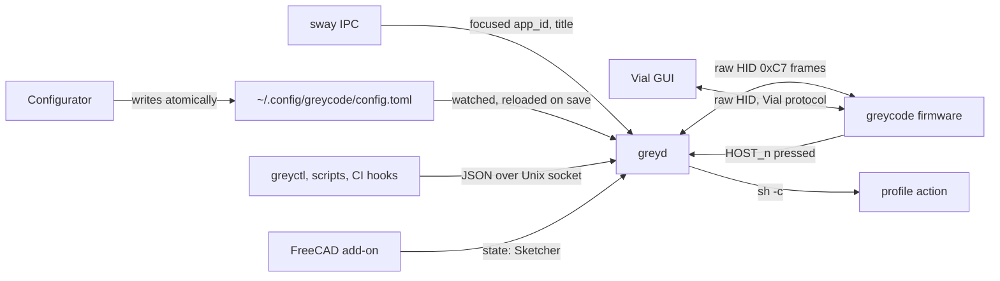

# Architecture and roadmap

> **Status: design files and software only. No hardware exists.** The board is generated and passes
> KiCad's checks but has not been ordered. The case is a model that passes its own checks but has not
> been milled. The firmware compiles; the host daemon runs and reads focus from sway, but has never
> talked to a pad.

## The pad

3 x 3 MX hot-swap keys, one EC11 knob with push, a 1.3" 128 x 64 OLED, 9 per-key RGB LEDs and
6 edge LEDs that light a slot in the case. RP2040, USB-C. Pins: [`board.toml`](../board.toml).

## How the parts fit

Two kinds of live configuration, each owned by one program:

| What | Owner | Stored | Applies |
|---|---|---|---|
| What each key, knob turn and layer does | **Vial** | on the pad (flash) | at once, as in any Vial board |
| Which app selects which layer, labels, colours, HOST actions | **greyd** config | on the PC (TOML) | within 1 s of saving the file |

That split is the core decision. Vial already gives live keymap editing, macros, tap dance, combos
and RGB control; rewriting that would cost months. greyd only has to say "layer 1 now", "show these
labels", "light the edge red".

### App-aware layers

1. sway reports a focus change, for example `app_id = "org.freecad.FreeCAD"`.
2. greyd matches it against the profiles (substring of app id or title, first match wins).
3. greyd sends PROFILE (layer 1, accent, name) and the nine LABELs.
4. The firmware makes layer 1 the default layer. Keys set to `KC_TRNS` in Vial fall through to the
   base layer, so a profile only needs the keys it changes.
5. With no match greyd sends PROFILE with no layer: back to the base layer.

The profile is the *default* layer, not a momentary one, so the FN layer (15, hold the knob) stays
above every profile.

### Alerts and key colours

`greyctl alert error "CI failed" --timeout 60` lights the edge slot and writes the text on the
OLED's last row. `greyctl keys 0,1 #00ff00` colours two keys until `greyctl keys 0,1 off`.
Anything that can run a command can use it: a CI watcher, a build script, a FreeCAD macro.

### Failure behaviour

| Event | Result |
|---|---|
| greyd stops or crashes | Pad times out after 5 s: base layer, lights back to the RGB effect |
| Pad unplugged | greyd keeps running, finds it again within 1 s of replug, resends the profile |
| Config file broken | greyd logs the error and keeps the last good config |
| Vial in front | greyd pauses (no frames); pad shows its base layer |
| Not on sway | greyd logs it; alerts and HOST keys work, app profiles do not |

### Security

- HOST actions are shell commands from the user's own config file. The pad sends only an index;
  it cannot choose a command.
- The control socket lives in `$XDG_RUNTIME_DIR` (mode 0700, the user's only) and has no request
  that runs a command.
- The firmware treats every host byte as untrusted: layer and key bounds are checked, text is
  clipped and limited to printable ASCII.

## Roadmap

| # | Slice | State |
|---|---|---|
| 1 | Firmware + host core | Done. QMK/Vial keyboard, host link, greyd, greyctl, tests, pin check |
| 2 | PCB (`pcb/`) | Generated and fully routed; DRC, ERC, parity and `board.toml` contract clean; JLCPCB files written. Not ordered |
| 3 | CNC case (`cad/`) | build123d model, checks, STEP/STL, renders. Not milled |
| 4 | Configurator (`configurator/`) | Core and UI logic tested. The Tauri window has not been built: it needs `webkit2gtk-4.1` |
| 5 | App state (`freecad/`, `[[profile.state]]`) | FreeCAD add-on reports the workbench and Sketcher; firmware layer 4 is the Sketcher layer. Add-on not run inside FreeCAD |
| 6 | Focus backends | sway (live), Hyprland and X11 (code and tests; X11 read once on XWayland). No KDE or GNOME Wayland backend |

Next, in order: order 5 boards and mill or print one case (see `pcb/README.md` and `cad/README.md`
for what to check first), measure every `MEASURE` value, then build the configurator window on a
machine with `webkit2gtk-4.1`.

## Open points

- **USB IDs** are the pid.codes test pair `1209:0001`. Get a real PID before giving boards away.
- **Knob pulses per detent** (4) and **OLED controller** (SH1106) are guesses until parts arrive.
- **OLED burn-in.** The OLED never blanks (`OLED_TIMEOUT 0`) so profile labels stay visible.
  Revisit after a week of real use.
- **Vial GUI and greyd share the interface.** Pausing while Vial has focus covers the common case;
  Vial left open in the background while greyd talks has not been tried.
