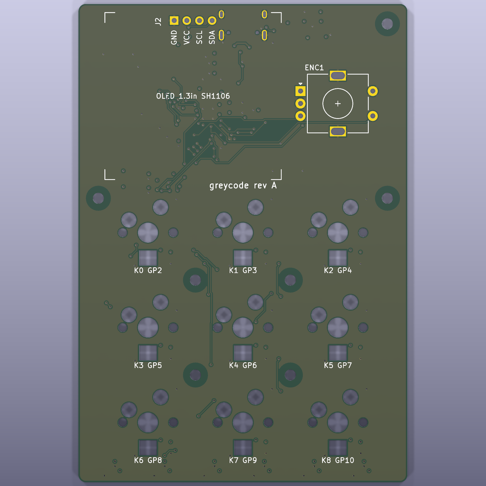
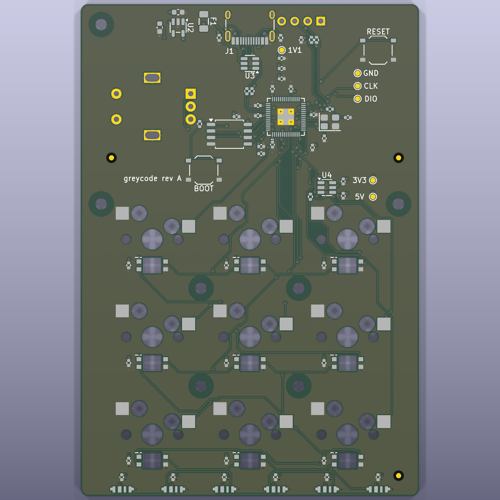
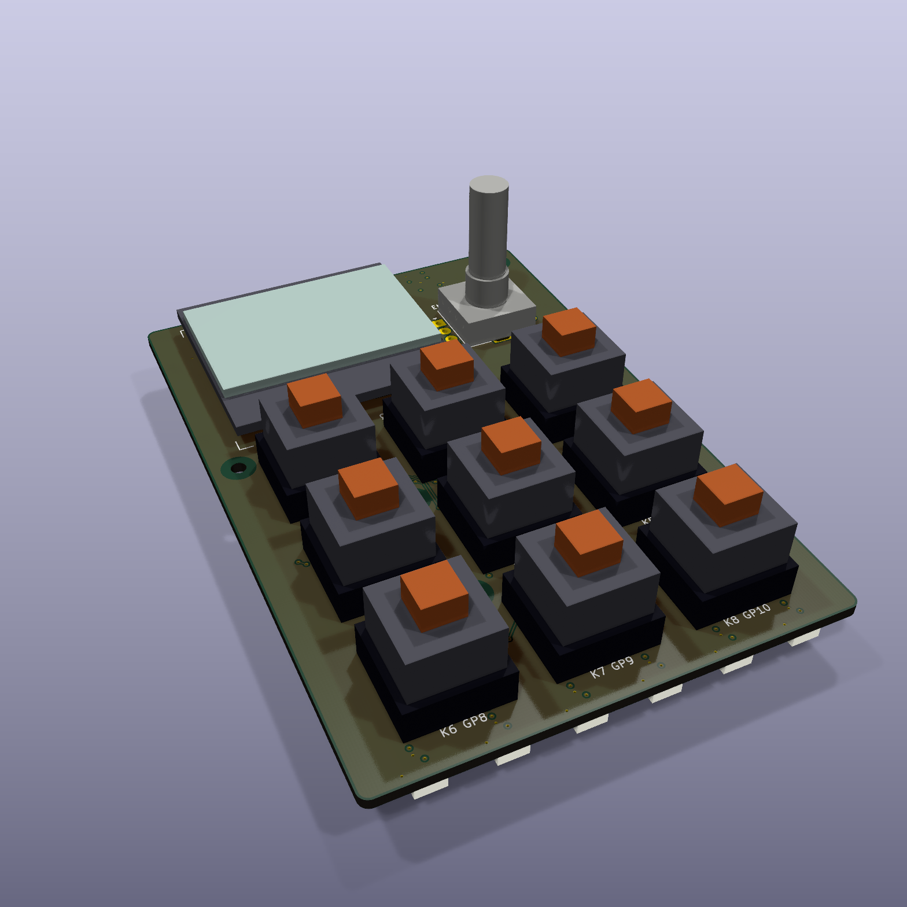
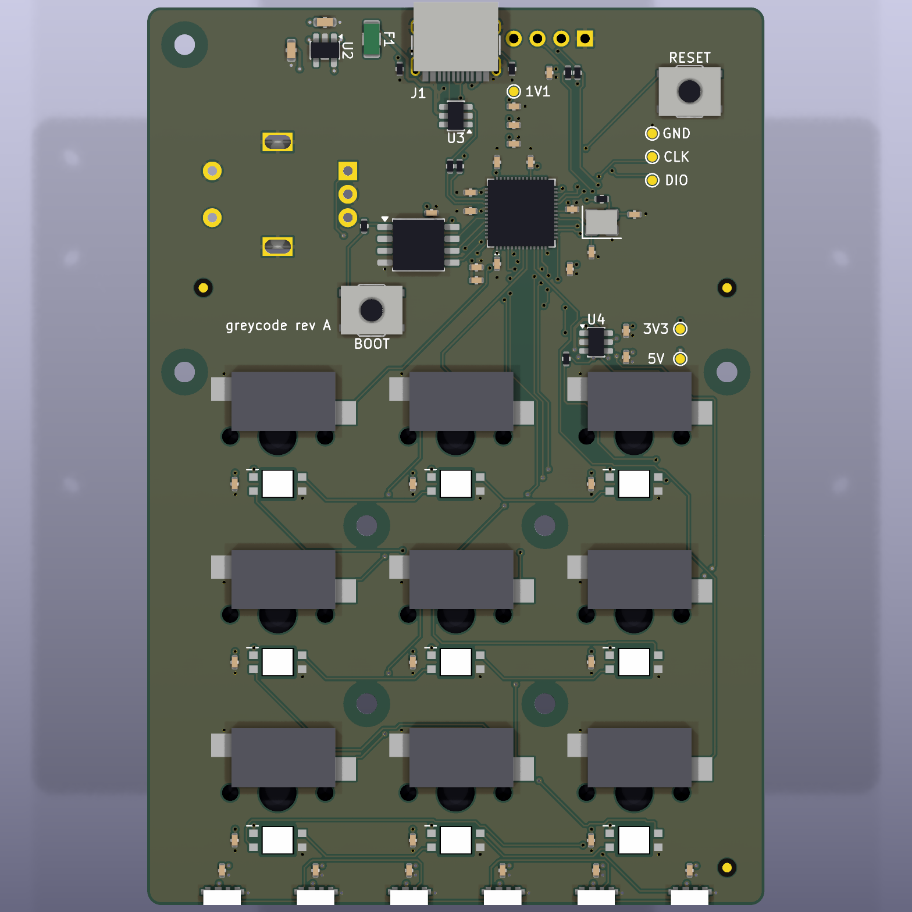

# PCB

The board is generated. Nothing in `pcb/kicad/` is drawn by hand: `make -C pcb place` writes the
schematic, the placed and routed board and the pictures in `docs/images/pcb/` from two inputs,
`board.toml` (outline, holes, positions, GPIOs) and `pcb/gen/circuit.py` (parts and nets). The
generator is adapted from `~/Projects/macropad/pcb`.

**Not built.** No board has been ordered, assembled or powered. Everything below is what the design
files say and what the automatic checks confirm, nothing more.

 

 

The part models are block models (`gen/models.py`) with heights typed from memory. They show where
things are and on which face; they are not for measuring.

## Status

Checked on 2026-11-15 with the commands below, KiCad 9.0.9 in Docker.

| Check | Result | Command |
|---|---|---|
| Placement, routing | 96 footprints, 55 nets; 892 tracks, 213 vias, 1330.1 mm; **0 unrouted pads** | `make -C pcb place` |
| Schematic ERC (all severities) | 0 errors, 0 warnings | `make -C pcb place` |
| Schematic netlist vs `circuit.py` | 272 pins match | `make -C pcb place` |
| DRC with schematic parity | 0 violations, 0 unconnected pads, 0 footprint errors | `make -C pcb check` |
| DRC at all severities | only the two accepted findings (J1, J2 differ from their library copy: silkscreen trimmed) | `make -C pcb place` |
| Board vs `board.toml` | 8 groups match: outline, 7 holes with keep-outs, 9 keys, knob, OLED header (pins in `OLED_PINS` order), USB-C (mouth 0.50 mm over), 15 LEDs, 15 GPIOs on their pins and 15 open with no copper | `make -C pcb check` |
| Rebuild repeatable | two `place` runs write byte-identical boards, sha256 `17e881e9...29e0` | `make -C pcb repeat` |
| Order files | 78 machine-placed parts on 22 BOM lines; Gerbers, drill files, BOM and CPL agree with the board | `make -C pcb fab` |
| Plain tests | 48 pass (router 15, schematic writer 19, circuit vs `board.toml` and firmware 11, order files 3) | `make -C pcb test` |
| Real hardware | **None** | - |

## Commands

| Command | Does | Time |
|---|---|---|
| `make -C pcb place` | Schematic, ERC, netlist compare, placement checks, routing, pours, DRC, length checks, contract, pictures. Fails on an unrouted pad after writing `routing.txt`. | about 4 min |
| `make -C pcb check` | `kicad-cli pcb drc --schematic-parity`, fails on any error or unconnected item; then the `board.toml` contract | 30 s |
| `make -C pcb fab` | Gerbers, drill files, `greycode-gerbers.zip`, JLCPCB BOM and CPL into `pcb/fab/`, then a check that they agree with the board | 30 s |
| `make -C pcb test` | Plain Python, no Docker: netlist self-check and the unit tests | 2 s |
| `make -C pcb repeat` | `place` twice, then `cmp` on the two board files | about 8 min |
| `make -C pcb order` | Search a routing order again after moving parts or pins; rewrites `gen/route_order.txt` | about 12 min |

KiCad runs in the pinned container `kicad/kicad:9.0.9` through `pcb/kicad.sh`.

## Circuit

[Schematic PDF](../docs/images/pcb/schematic.pdf), [SVG](../docs/images/pcb/schematic.svg). One A3 sheet,
drawn from `circuit.py` with KiCad's own symbols (RP2040, W25Q128JVS, AP2112K-3.3, USBLC6-2SC6,
SN74LVC1T45DBV, USB-C 16P, EC11). `schematic.check_mcu_pins` holds every RP2040 pin in `circuit.py`
against KiCad's RP2040 symbol.

| Block | Parts |
|---|---|
| MCU | RP2040 (QFN-56, bottom face), W25Q128JVSIQ on QSPI, ABM8-272-T3 12 MHz with 15 pF and 1 k, per "Hardware design with RP2040" |
| MCU supply | 100 nF on each IOVDD, DVDD, USB_VDD and ADC_AVDD pin; 1 uF on VREG_VIN and VREG_VOUT (internal 1.1 V regulator); TESTEN to GND |
| USB | HRO TYPE-C-31-M-12 (bottom face, centred on `usb_x`), 5.1 k on CC1/CC2, USBLC6-2SC6, 27 ohm on D+/D-, nSMD050 500 mA polyfuse, AP2112K-3.3 |
| Buttons | BOOT: QSPI_SS to GND through 1 k. RESET: RUN to GND (RUN's internal pull-up, no external one). Both TS-1187A on the bottom face |
| Keys | 9 MX hot-swap sockets on the bottom face, each between its GPIO and GND, no diodes. Footprint drawn from Kailh CPG151101S11; the BOM orders HanElectricity CPG151101S11-2 (C49352235), see open points |
| Knob | EC11E18244AU at `pcb.knob`: A, B, push to GPIO 12/13/11, C and S2 to GND (internal pull-ups) |
| OLED | 1x4 header GND, VCC (3.3 V), SCL, SDA on GPIO 15/14 (I2C1), 4.7 k pull-ups |
| LEDs | 74LVC1T45 (A at 3.3 V, B at 5 V, DIR high) then 330 ohm, then one chain: 9 x SK6812MINI-E reverse-mounted under the keys, then 6 x SK6812 SIDE-A on the front edge, 100 nF each. Chain order = `keyboard.json` order (checked) |
| Probe pads | SWCLK, SWDIO, GND, 5V, 3V3, 1V1 on the bottom face |

## Board

66 x 96 mm, r 1.5, 1.6 mm, 4 layers, seven M2 holes with 5 mm keep-outs on every copper layer
(rule areas), all from `board.toml`. Every machine-placed part is on the bottom face, so JLCPCB
assembles one side. The encoder and the OLED header are through-hole on the top face, hand-soldered.

| Layer | Use |
|---|---|
| F.Cu | Signals that cross others, ground pour |
| In1.Cu | 5 V plane; 3.3 V island over the strip behind the keys; 1.1 V island under the MCU with a lobe to its capacitors |
| In2.Cu | Ground plane, unbroken |
| B.Cu | All machine-placed parts, most tracks, ground pour |

Drawings: [top](../docs/images/pcb/copper-top.svg), [power](../docs/images/pcb/copper-power.svg),
[ground](../docs/images/pcb/copper-ground.svg), [bottom](../docs/images/pcb/copper-bottom.svg),
assembly [top](../docs/images/pcb/assembly-top.svg), [bottom, mirrored](../docs/images/pcb/assembly-bottom.svg).

Design rules (`layout.py`, written into `kicad/greycode.kicad_pro`): 0.15 mm track and clearance,
0.6/0.3 mm vias, 0.3 mm copper to edge. These are the sibling board's JLCPCB 4-layer values; check
them against JLCPCB's capability page on the day you order.

Routing: `gen/router.py` is a two-layer grid router (no autorouter program). `gen/route.py` runs it
in order: four ground vias in the exposed pad, every MCU supply pin with its capacitor and hand-placed
vias, crystal and ESD ground vias, SWD/RUN escapes, USB and crystal nets, VBUS, flash, one via to the
plane for every other supply pad, LED links inside a key row, MCU signals one escape at a time, the
rest shortest first. `gen/route_order.txt` (found by `make -C pcb order`) moves I2C_SCL, I2C_SDA and
ENC_B to the front.

Routed lengths (`routing.txt`): USB connector to MCU D+ 23.42 mm, D- 21.32 mm; XIN 6.40, XOUT 8.10,
XTAL_DRIVE 3.75 mm; QSPI 4.86 to 15.73 mm. The 15 mm QSPI limit (`route.QSPI_LENGTH_LIMIT`) holds
for every QSPI net but QSPI_SS (15.73 mm), which `route.check_sensitive_lengths` leaves out because
it runs on past the flash to the BOOT button's 1 k resistor.

## Order files (`pcb/fab/`)

`greycode-gerbers.zip` (11 Gerber layers, PTH and NPTH drill files), `bom-jlcpcb.csv` (Comment,
Designator, Footprint, LCSC Part #, Manufacturer, Manufacturer Part #), `cpl-jlcpcb.csv`
(Designator, Mid X, Mid Y, Layer, Rotation; Y negative as JLCPCB's KiCad flow writes it) and
`board-sha256.txt`, the board they were made from. `make -C pcb test` fails if the board changes
after `make -C pcb fab`.

LCSC numbers: the parts shared with `~/Projects/macropad` were checked there on 2026-11-12. RP2040
(C2040), W25Q128JVSIQ (C97521), SK6812MINI-E (C5149201) and 4.7 k 0402 (C25900) were checked
against their JLCPCB part pages on 2026-11-15: part number and package only, not stock or price.

Hand-soldered, not in the BOM: EC11E18244AU (C202365) and the 1x4 header (C2337 strip, only if the
OLED module comes without pins).

## Open points

Nothing below is verified on hardware.

- **Bottom-side rotations in the CPL.** KiCad's rotation is written unchanged for bottom parts, and
  the placement point is the body centre. JLCPCB sometimes wants a correction on bottom parts. Check
  every part in JLCPCB's placement preview before paying, especially U1, U5, the LEDs and J1.
- **SK6812MINI-E footprint.** Pin functions (1 VDD, 2 DOUT, 3 GND, 4 DIN) agree with the OPSCO and
  Mutipower pin tables. Pad size, pad positions, cut-out size and which corner pin 1 lands on when
  the part is mounted upside down are guesses (MEASURE). Also ask JLCPCB whether they place
  reverse-mount MINI-E parts; not confirmed.
- **Part substitutions against the brief.** (1) The brief names Kailh hot-swap sockets; the BOM
  orders HanElectricity CPG151101S11-2 (LCSC C49352235), the part the sibling board uses. The
  footprint is drawn from Kailh's CPG151101S11 drawing; that the HanElectricity part shares its pad
  pattern is a guess from the part number (MEASURE against its datasheet, or swap in Kailh's LCSC
  number before ordering). (2) The brief does not list R9, a 330 ohm resistor between the level
  shifter and the first LED, added because the SK6812 SIDE-A datasheet asks for one in the data line.
  (3) Parts the brief left to me: USB-C HRO TYPE-C-31-M-12, fuse TECHFUSE nSMD050; LCSC stock not
  checked.
- **SK6812 SIDE-A pin order** comes from the sibling's footprint (MEASURE).
- **OLED header.** Pin order GND VCC SCL SDA and the row 1.6 mm inside the module's back edge are
  guesses (`circuit.OLED_PINS`, `OLED_HEADER_INSET`, MEASURE). Modules with VCC and GND swapped exist.
  The contract holds the board's header pins, left to right, against `circuit.OLED_PINS`. The module
  size 35.4 x 33.5 mm is typed into `circuit.OLED_MODULE_SIZE` from a comment in `board.toml`, and the
  contract reuses that copy, so "header at the module's back" is not an independent check until
  `board.toml` gets a `pcb.oled_module_size` key (requested).
- **USB-C on the bottom face**, mouth 0.5 mm past the back edge (`circuit.USB_MOUTH_OVERHANG`; the
  contract measures the fab outline without its line width and prints the same 0.50 mm). The case
  needs to know both; they are not in `board.toml` yet.
- **Buttons on the bottom face** need holes in the case floor: BOOT at board.toml (42.0, 63.6), RESET
  at (8.0, 87.0).
- **LED current.** 15 LEDs at up to about 60 mA each at full white is about 0.9 A; the polyfuse holds
  500 mA. The firmware's `max_brightness` 160/255 still allows about 0.56 A. Nobody has measured it.
- **1.1 V decoupling.** The DVDD and VREG_VOUT capacitors (C8, C9, C10) sit 7 to 12 mm from their
  pins and reach them through the 1.1 V island on In1, not by a track. IOVDD pin 10's capacitor (C2)
  also connects through the plane. The RP2040 guide wants them close; this is the compromise the
  pin-out allowed.
- **Two length checks were loosened after the first full route**, both numbers picked without a
  datasheet: the USB D+/D- mismatch limit from the sibling's 2.0 mm to 3.0 mm (measured 2.09 mm), and
  the MCU-side stub of each 27 ohm resistor from 6 mm to 8 mm (measured 7.16 and 7.53 mm). Full-speed
  USB does not care at these sizes; the reasons are in `route.py`. No USB impedance was calculated.
- **VBUS capacitance.** 2.2 uF plus 16 x 100 nF on 5 V (about 3.8 uF); the 10 uF on 3.3 V sits behind
  the regulator. Not measured at plug-in.
- **Crystal** uses Raspberry Pi's reference values; the oscillator is not measured.
- **Fiducials** are three 1 mm marks on the bottom face; JLCPCB adds its own tooling holes.
- **No teardrops**, thermal reliefs only on through-hole pads.
- **Schematic** is generated and passes ERC; no engineer has reviewed it as a drawing.

## Files

| Path | What |
|---|---|
| `gen/circuit.py` | Every part, its LCSC and manufacturer number, position, rotation and nets. Pure Python |
| `gen/layout.py` | Footprints, outline, planes, keep-outs, design rules, exposed-pad paste windows, placement checks |
| `gen/router.py`, `gen/route.py`, `gen/route_order.txt` | Grid router, routing plan, routing order |
| `gen/schematic.py`, `gen/sheet_layout.py`, `gen/symlib.py`, `gen/sexpr.py` | Schematic writer |
| `gen/contract.py` | The routed board against `board.toml` |
| `gen/silk.py`, `gen/models.py` | Silkscreen text, block 3D models |
| `gen/fab.py` | JLCPCB BOM and CPL and their checks |
| `gen/build.py` | The steps: `place`, `order`, `contract`, `fab` |
| `gen/test_*.py` | Plain Python tests |
| `kicad/` | Generated KiCad 9 project |
| `lib/` | Project footprints (`lib/SOURCES.txt`) and generated block models |
| `fab/` | Generated order files |
| `routing.txt`, `netlist.txt` | Generated routing report and netlist |
